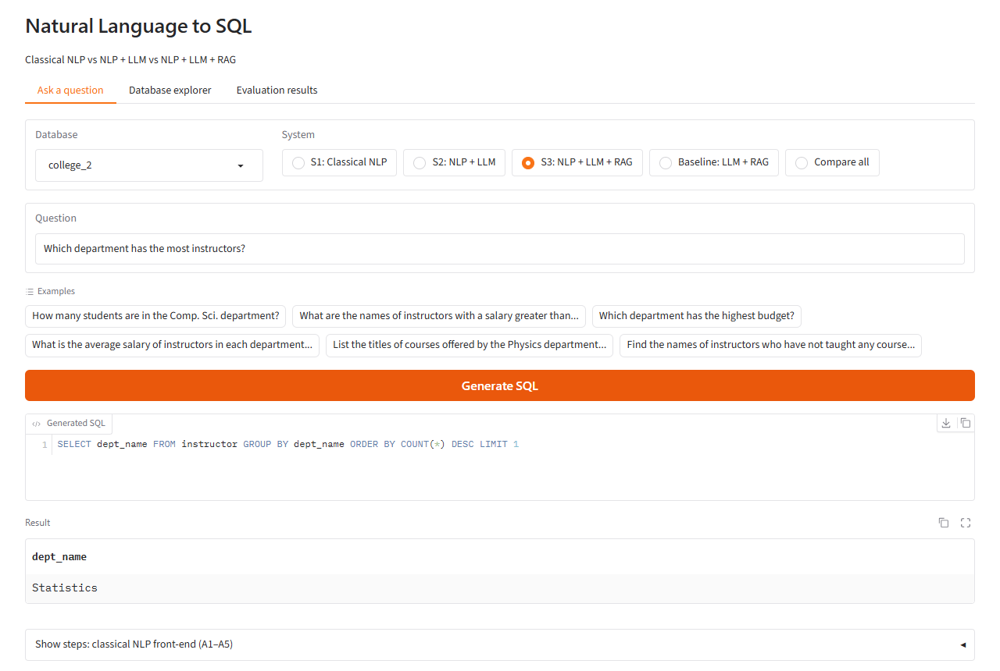
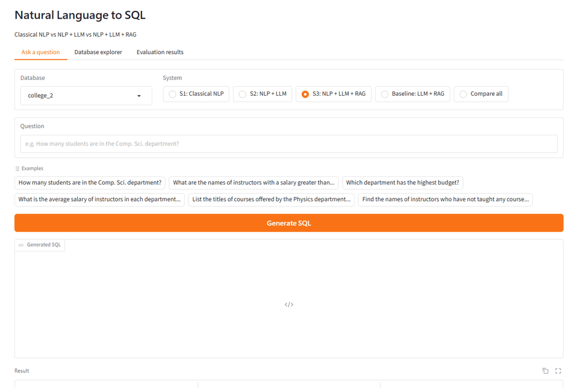

# Natural Language to SQL: Classical NLP vs NLP + LLM vs NLP + LLM + RAG

  -orange) 

A controlled comparison of three ways to turn English questions into SQL, run on the **Spider** benchmark with
the same local LLM, the same databases and the same metric: **(1) classical NLP** — a spaCy pipeline with keyword
matching, WordNet synonyms, fuzzy matching and rule templates; **(2) NLP + LLM** — the same NLP analysis passed as
hints to `qwen2.5-coder:7b`; and **(3) NLP + LLM + RAG** — the same plus similar solved examples retrieved with
sentence embeddings and FAISS, with an **LLM + RAG** baseline that isolates what the NLP hints add. The design
follows the schema-linking study in Nascimento et al. (*Data & Knowledge Engineering*, 2026). The project includes
a web interface, a read-only SQL safety guard, an automatic test-leakage check, paired significance tests and an
error analysis. Everything runs locally; no API keys are needed.



## Results

Execution accuracy (%) — the generated SQL returns the same rows as the correct SQL. Difficulty levels are
Spider's official Easy / Medium / Hard / Extra.

**Spider dev — 200 questions (50 per level) on 20 databases never used during development**

| System | Easy | Medium | Hard | Extra | **All** | Table F1 |
|---|---|---|---|---|---|---|
| S1: Classical NLP | 62.0 | 26.0 | 16.0 | 12.0 | **29.0** | 0.894 |
| S2: NLP + LLM | 94.0 | 78.0 | 74.0 | 52.0 | **74.5** | 0.955 |
| S3: NLP + LLM + RAG | 94.0 | 80.0 | 62.0 | 54.0 | **72.5** | 0.963 |
| Baseline: LLM + RAG | 90.0 | 80.0 | 56.0 | 48.0 | **68.5** | 0.961 |

**`college_2` (university database, all 170 questions)**

| System | Easy | Medium | Hard | Extra | **All** | Table F1 |
|---|---|---|---|---|---|---|
| S1: Classical NLP | 41.7 | 17.3 | 7.6 | 14.3 | **16.5** | 0.769 |
| S2: NLP + LLM | 79.2 | 78.8 | 54.5 | 71.4 | **68.2** | 0.902 |
| S3: NLP + LLM + RAG | 83.3 | 84.6 | 71.2 | 75.0 | **77.6** | 0.945 |
| Baseline: LLM + RAG | 87.5 | 92.3 | 68.2 | 82.1 | **80.6** | 0.973 |

System 1 on all 1,034 dev questions: **26.1%**. Full tables, McNemar tests and charts are in
[`results/`](results/); failure categories with examples are in `results/*/error_analysis.md`.

### Findings
1. **Adding an LLM to classical NLP is by far the biggest gain** (+45.5 points on dev, +51.7 on `college_2`;
   McNemar p < 0.0001 on both). Rules handle simple lookups but cannot express nested queries, set operations or
   negation, and the gap grows with difficulty.
2. **RAG helps only when the example pool covers the same domain.** For `college_2`, 53% of retrieved examples
   come from two other university databases (mean similarity 0.711) and RAG adds +9.4 points (p = 0.004). For the
   dev databases only 6% do (mean similarity 0.623) and RAG makes no significant difference (p = 0.58): the 7B
   model copies unnecessary joins and re-cases stored values (`'Cat'` instead of `'cat'`). Nascimento et al.
   report the same "retrieved examples confused the LLM" effect.
3. **NLP hints help when keyword matching is precise and hurt when it over-links tables.** On dev the hints cut
   SQL errors from 8 to 5. On `college_2` many tables share column names (`dept_name`, `ID`, `course_id`), the
   front-end links extra tables (front-end table F1 0.769), the LLM follows them, and LLM + RAG *without* hints
   is best (significantly better than S2, p = 0.0001; not different from S3, p = 0.33).

## Quick start

**Requirements:** Python 3.13, [Ollama](https://ollama.com/download), ~8 GB RAM for the 7B model (a GPU helps
but is not required), ~10 GB of disk (model 4.7 GB, Python packages ~3 GB, Spider ~1 GB).

**1. Clone (with the Spider evaluation scripts submodule) and install**

Windows (PowerShell):
```powershell
git clone --recurse-submodules https://github.com/Shreya-Raj08/nl2sql-classical-vs-llm-rag.git
cd nl2sql-classical-vs-llm-rag
python -m venv .venv
.venv\Scripts\activate
pip install torch==2.14.1 --index-url https://download.pytorch.org/whl/cpu
pip install -r requirements.txt
```

macOS / Linux:
```bash
git clone --recurse-submodules https://github.com/Shreya-Raj08/nl2sql-classical-vs-llm-rag.git
cd nl2sql-classical-vs-llm-rag
python3 -m venv .venv
source .venv/bin/activate
pip install torch==2.14.1 --index-url https://download.pytorch.org/whl/cpu   # Linux
# pip install torch==2.14.1                                                   # macOS (default index)
pip install -r requirements.txt
```

Then, on any OS:
```bash
python -c "import nltk; [nltk.download(p) for p in ('wordnet','omw-1.4','punkt','punkt_tab')]"
ollama pull qwen2.5-coder:7b
```
(Already cloned without submodules? Run `git submodule update --init`.)

**2. Download Spider** (not included — 200 SQLite databases, ~1 GB unzipped)

Download `spider_data.zip` from the official site, https://yale-lily.github.io/spider, and unzip it into `data/` so
that `data/spider_data/database/`, `tables.json`, `train_spider.json` and `dev.json` exist. If the official Google
Drive link reports "quota exceeded", an unofficial mirror of the same file (205,800,266 bytes) is at
`https://huggingface.co/datasets/HAL-9001/spider-databases/resolve/main/spider_data.zip`.

**3. Run**
```bash
python app.py        # opens http://127.0.0.1:7860
```
The first start builds the RAG example index (downloads the 90 MB embedding model, ~1–2 min) and runs the
leakage check. The first LLM answer takes ~1 minute while the model loads; later answers take 3–10 s.

> **HTTPS errors when downloading models?** Some networks inspect HTTPS traffic with their own certificate. The
> project uses [`truststore`](https://pypi.org/project/truststore/) so Python trusts the operating system's
> certificate store (certificate checks stay on). If `pip` cannot reach GitHub for the spaCy model, install the
> wheel URL listed in `requirements.txt` directly.

## Demo



*Compare all* runs the four systems on one question. Here classical NLP's rules cannot express the negation and
return 132 rows,
while all three LLM systems produce `SELECT name FROM instructor WHERE ID NOT IN (SELECT ID FROM teaches)` (19
rows). The **Show steps** panels display every NLP step, the retrieved examples and the exact prompt sent to the
LLM. A walkthrough with tested questions is in [docs/DEMO_GUIDE.md](docs/DEMO_GUIDE.md).

## How it works

| System | Pipeline |
|---|---|
| **S1: Classical NLP** | NLP front-end → rule templates → SQL. No LLM. |
| **S2: NLP + LLM** | NLP front-end → hints + schema → LLM → SQL |
| **S3: NLP + LLM + RAG** | NLP front-end + 3 retrieved examples → hints + examples + schema → LLM → SQL |
| **Baseline: LLM + RAG** | 3 retrieved examples + schema → LLM → SQL (no NLP hints) |

**Shared classical NLP front-end** ([`src/nlp_frontend.py`](src/nlp_frontend.py)), a simplified version of the
DANKE keyword-search service in Nascimento et al.:
- **A1 Preprocessing** — tokenization, lemmatization, POS tagging, dependency parsing, NER (spaCy)
- **A2 Keyword extraction** — n-grams, noun chunks, named entities, numbers, quoted values
- **A3 Keyword matching** — a per-database dictionary of table and column names (with abbreviation expansion and
  WordNet synonyms) and every stored text value; matched exactly, by lemma, by synonym or fuzzily (rapidfuzz)
- **A4 Schema linking** — tables needed and the join path (Steiner tree over the foreign-key graph, networkx)
- **A5 Intent cues** — rules for COUNT/AVG/SUM/MAX/MIN, comparisons, superlatives, grouping, ordering, negation

**LLM** ([`src/llm.py`](src/llm.py)) — `qwen2.5-coder:7b` via Ollama, temperature 0, schema given as
`CREATE TABLE` statements (as recommended by DAIL-SQL), one self-correction retry when SQLite reports an error.

**RAG** ([`src/rag.py`](src/rag.py)) — the 3 most similar of 6,816 Spider training questions (with their SQL),
found with all-MiniLM-L6-v2 embeddings and a FAISS inner-product index (dynamic few-shot examples, as in DAIL-SQL).

**Safety and evaluation integrity**
- Read-only SQLite connection; exactly one `SELECT` statement may run (`DELETE`, `DROP`, `UPDATE`, `PRAGMA`,
  multiple statements are refused); 10-second query time limit ([`src/safety.py`](src/safety.py)).
- **No test leakage:** every test database (all 20 dev databases and `college_2`) is removed from the RAG pool,
  as is any training question that is identical or a near-identical paraphrase (cosine ≥ 0.95) of a test
  question. `rag.check_leakage()` re-verifies this before every evaluation and at start-up and stops on any
  overlap. Result for the published runs: 0 database, 0 exact and 0 near-duplicate overlaps over 1,204 test
  questions.
- The prompts were fixed before the test results were seen and were not tuned on the test sets.

## Reproducing the results
```bash
python evaluate.py --testset dev --all --systems classical   # S1 on all 1,034 dev questions   (~1 min)
python evaluate.py --testset dev --per-level 50               # 200 dev questions, 4 systems     (~70 min)
python evaluate.py --testset college_2 --all                  # 170 college_2 questions, 4 systems (~75 min)
python error_analysis.py --testset dev
python error_analysis.py --testset college_2_all
```
Times are for a laptop with an Intel Core Ultra 7 155U, 32 GB RAM and an RTX 3050 (4 GB). Runs are resumable
(re-running skips finished questions). The dev sample is drawn with seed 42. Even at temperature 0, LLM outputs
can differ slightly between runs and machines (GPU/CPU floating-point order); in two runs of the unchanged
LLM + RAG baseline the dev accuracy moved by 1 point (69.5 → 68.5). Results are written to
`results/<testset>/` (`predictions.csv`, `summary.md`, charts, `leakage_check.json`).

## Tests
```bash
pip install -r requirements-dev.txt
pytest
```
27 tests cover the safety guard, the leakage check (with a fake pool, no data needed), SQL extraction, result
matching, the significance test, the NLP intent rules and System 1 end-to-end (skipped if Spider is not downloaded).

## Project structure
```
app.py               Gradio interface (Ask a question / Database explorer / Evaluation results)
evaluate.py          evaluation, charts, McNemar significance tests
error_analysis.py    failure categories with example questions
config.py            paths, model, top-k, time limits
src/nlp_frontend.py  classical NLP front-end (A1–A5)
src/classical.py     System 1 rule templates
src/llm.py           prompts, SQL extraction, self-correction
src/rag.py           FAISS example pool + leakage guard
src/safety.py        SELECT-only guard + read-only execution
src/pipeline.py      runs one question through one system
src/spider_data.py   schemas, foreign keys, questions, stored values
tests/               pytest suite
results/             published evaluation outputs
docs/                demo guide and images
test-suite-sql-eval/ official Spider evaluation scripts (git submodule; used for difficulty levels)
```

## Limitations
- One local 7B model; larger models typically benefit more from retrieved examples.
- The LLM systems were evaluated on a stratified 200-question dev sample, so differences of a few points are within
  noise — see the McNemar p-values.
- Execution accuracy on a single database copy can occasionally count a wrong query as correct.
- `college_2` data is synthetic (randomly generated, from the *Database System Concepts* textbook schema).
- Simplified from Nascimento et al.: no knowledge graph, no view synthesis, no synthetic example generation.

## Future work
1. **Better example retrieval for RAG.** RAG only helped when the pool contained databases from the same domain
   (finding 2). Try masked-question similarity (DAIL-SQL: mask table, column and value words before embedding, so
   retrieval matches the *structure* of a question rather than its topic) and same-database synthetic examples (as
   in Nascimento et al.), and check whether RAG then helps on the Spider dev databases too.
2. **Put retrieved examples before the target schema.** The 7B model sometimes copies joins and value casing from
   examples placed right before the question; DAIL-SQL puts examples first, then the target schema and question.
   Compare both layouts on a held-out split, not on the test set.
3. **Tighter table selection in the NLP front-end.** On `college_2` the keyword matcher links extra tables that
   share column names and the LLM follows them (finding 3). Prune linked tables that contribute no selected column
   or condition, and report schema-linking precision before and after.
4. **Larger or different LLMs.** Repeat the comparison with a larger open model to see whether the RAG and
   NLP-hint effects change with model size.
5. **Test-suite execution accuracy.** Use the distilled test-suite databases from `test-suite-sql-eval` so that a
   wrong query cannot be counted as correct just because it happens to return the same rows.
6. **Full Spider dev set for every system.** Evaluate the LLM systems on all 1,034 dev questions, not a
   200-question sample, to tighten the confidence intervals.
7. **Conversational follow-up questions.** Support follow-ups such as "and only those in Physics?" by carrying the
   previous question and SQL as context (CoSQL / SParC benchmarks).

## References
1. E. R. Nascimento et al., "A Text-to-SQL strategy based on large language models and knowledge graphs for
   real-world databases," *Data & Knowledge Engineering* 164, 102580, 2026. https://doi.org/10.1016/j.datak.2026.102580
2. D. Gao et al., "Text-to-SQL Empowered by Large Language Models: A Benchmark Evaluation" (DAIL-SQL),
   *Proc. VLDB Endowment* 17(5), 2024. https://doi.org/10.14778/3641204.3641221
3. B. Li, Y. Luo, C. Chai, G. Li, N. Tang, "The Dawn of Natural Language to SQL: Are We Fully Ready?",
   *Proc. VLDB Endowment* 17(11), 3318–3331, 2024. https://doi.org/10.14778/3681954.3682003
4. X. Liu et al., "A Survey of Text-to-SQL in the Era of LLMs: Where Are We, and Where Are We Going?",
   *IEEE Transactions on Knowledge and Data Engineering* 37(10), 5735–5754, 2025. https://doi.org/10.1109/TKDE.2025.3592032
5. M. Liu et al., "A systematic review of natural language interfaces for databases," *Frontiers of Computer
   Science* 20(11), 2026. https://doi.org/10.1007/s11704-025-50592-w
6. T. Yu et al., "Spider: A Large-Scale Human-Labeled Dataset for Complex and Cross-Domain Semantic Parsing and
   Text-to-SQL Task," *EMNLP* 2018. https://doi.org/10.18653/v1/D18-1425

## Acknowledgements and license
- Code: [MIT License](LICENSE), © 2026 Shreya Raj. Originally developed as a team course project (Natural Language
  Processing, B.M.S. College of Engineering).
- Spider dataset: CC BY-SA 4.0 (Yu et al., 2018) — not redistributed here; `results/` quotes Spider questions and
  SQL for evaluation purposes.
- [test-suite-sql-eval](https://github.com/taoyds/test-suite-sql-eval): Apache 2.0, included as a git submodule.
- Built with spaCy, NLTK/WordNet, rapidfuzz, networkx, sqlglot, sentence-transformers, FAISS, Gradio and Ollama.
