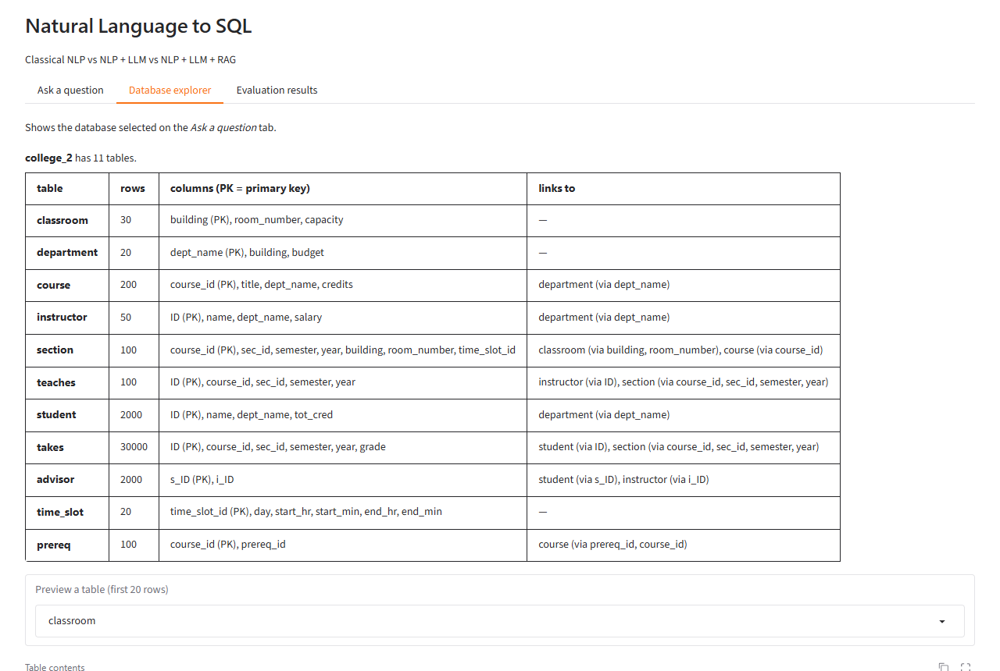

# Demo guide

A walkthrough of the interface: what to ask, what each panel shows, and how to read it.

## Before you start
- Start Ollama (it must show `qwen2.5-coder:7b` in `ollama list`), then run `python app.py` and open
  http://127.0.0.1:7860.
- The terminal prints `RAG leakage check: ... 'status': 'PASSED (zero overlap)'` at start-up.
- The **first** LLM answer takes about a minute (the 4.7 GB model is loaded into memory); afterwards answers
  take 3–10 s. **Compare all** runs all four systems (≈10–30 s).

## The three tabs
| Tab | What it is for |
|---|---|
| **Ask a question** | Pick a database and a system (or *Compare all*), type a question, get the SQL and its result |
| **Database explorer** | Every table of the selected database with row counts, columns, keys and links; a 20-row preview of any table; example questions written for that database in Spider |
| **Evaluation results** | The results tables, significance tests and charts from `evaluate.py` |



## Tested example questions (database `college_2`)
✓ = returns the same rows as the correct SQL. Tested with the code in this repository.

| Spider level | Question | S1 | S2 | S3 | LLM + RAG | What it shows |
|---|---|---|---|---|---|---|
| easy | How many classrooms are in the Lamberton building? | ✓ | ✓ | ✓ | ✓ | Value matching ("Lamberton" is found in the data) |
| easy | How many students are in the Comp. Sci. department? | ✓ | ✓ | ✓ | ✓ | Value matching with punctuation |
| easy | List the titles of courses offered by the Physics department. | ✓ | ✓ | ✓ | ✓ | RAG and prompt panels (explained below) |
| medium | Which department has the highest budget? | ✓ | ✓ | ✓ | ✓ | Superlative → `ORDER BY budget DESC LIMIT 1` |
| medium | What is the average salary of instructors in each department? | ✓ | ✓ | ✓ | ✓ | AVG + "each" → `GROUP BY` |
| hard | Which department has the most instructors? | ✓ | ✓ | ✓ | ✓ | Rule "X with the most Y" → `GROUP BY … ORDER BY COUNT(*)` |
| hard | What are the names of instructors who earn more than the average salary? | ✗ | ✓ | ✓ | ✓ | Rules cannot build a nested sub-query |
| hard | Find the names of instructors who have not taught any course. | ✗ | ✓ | ✓ | ✓ | Negation → `NOT IN (SELECT …)` (19 names) |
| hard | Which courses do not have any prerequisites? Give their titles. | ✗ | ✗ | ✓ | ✓ | S2 uses the wrong direction of `prereq` (`prereq_id` instead of `course_id`) |
| — | Delete all students from the Physics department. | — | blocked | — | — | The LLM writes `DELETE FROM student …`; the safety guard refuses to run it |

Tip: "Find the names of students who have never taken a course" is answered correctly but returns 0 rows
(every student in this synthetic data took a course), which can look like a failure.

## Reading "Show steps: classical NLP front-end (A1–A5)"
| Key | Technique | Example |
|---|---|---|
| A1 tokens / lemmas | Tokenization, lemmatization (spaCy) | "students" → "student", "took" → "take" |
| A1 POS tags | Part-of-speech tagging | NOUN, VERB, PROPN, NUM |
| A1 dependency parse | Dependency parsing | `students --nsubj--> are` |
| A1 named entities | NER | "the Physics department" (ORG), "more than 100" (CARDINAL) |
| A2 noun chunks | Phrase chunking | "the Physics department" |
| A3 keyword matches | Keyword search, fuzzy matching, WordNet synonyms | "teacher" → table `instructor` (synonym); "Comp. Sci." → stored value in `dept_name` |
| A4 linked tables / join path | Schema linking, Steiner tree over foreign keys | `course.dept_name = department.dept_name` |
| A5 intent cues | Rule-based intent detection | "how many" → COUNT, "more than 100" → `> 100`, "each" → GROUP BY |

spaCy's general English model is imperfect on domain names (it splits "Comp. Sci." into two entities), which is
why A3 matches values against the database itself rather than relying on NER.

## Reading the RAG and prompt panels
Example: *"List the titles of courses offered by the Physics department."* with **S3: NLP + LLM + RAG**.

**Show steps: retrieved examples (RAG).** The question is embedded (all-MiniLM-L6-v2, 384 dimensions) and FAISS
returns the 3 most similar of 6,816 solved Spider training questions. The demo database and every test question
are excluded from this pool.

| Similarity | Source database | Why it was retrieved |
|---|---|---|
| 0.577 | e_learning | Courses grouped by subject — overlapping vocabulary |
| 0.575 | e_learning | Same *structure*: list course details where a category equals a value (JOIN + WHERE) |
| 0.574 | college_3 | Lists course names with one condition |

Similarities around 0.57 mean "similar shape, not the same question"; the examples teach a SQL pattern, not the
answer (their tables do not exist in `college_2`).

**Show steps: prompt sent to the LLM** — four parts:
1. **Schema**: the `CREATE TABLE` statements of the database.
2. **Hints from the NLP analysis**: `"titles"` → column `course.title`; `"courses"` → table `course`;
   `"Physics"` → stored value `'Physics'` in `department.dept_name` (exact spelling); `"department"` → table
   `department`; tables likely needed; join path `course.dept_name = department.dept_name`.
3. **Examples**: the three retrieved question → SQL pairs.
4. **The question**, ending with `SQL:`.

A system instruction is also sent ("You are an expert SQLite developer… Return only the SQL query."); temperature
is 0 and one self-correction retry is allowed if SQLite reports an error.

The model answers:
```sql
SELECT T1.title FROM course AS T1 JOIN department AS T2 ON T1.dept_name = T2.dept_name WHERE T2.dept_name = 'Physics'
```
It follows the hints (value, join path, output column) and copies the `T1`/`T2` alias style from the examples.
The join with `department` is unnecessary — `course` already has `dept_name` — but the result is correct. It is a
small instance of finding 3 in the README: the front-end suggested an extra table and the LLM followed it.

## Frequently asked questions
**Why these three systems?** They mirror Table 2 of Nascimento et al. (DKE 2026): keyword search alone,
keyword search + LLM, keyword search + retrieved examples + LLM. Each system adds one component, so each
accuracy difference can be attributed to that component.

**Why didn't RAG always help?** The examples come from other databases and a 7B model copies their patterns
(extra joins, different value casing). It helped on `college_2` because the pool contains two other university
databases.

**How is test leakage prevented?** Test databases are removed from the example pool, as are identical and
near-identical (cosine ≥ 0.95) questions; an automatic check stops every run if any overlap remains.

**Why a local model?** No data leaves the machine, there is no cost, and results are reproducible (temperature 0).
